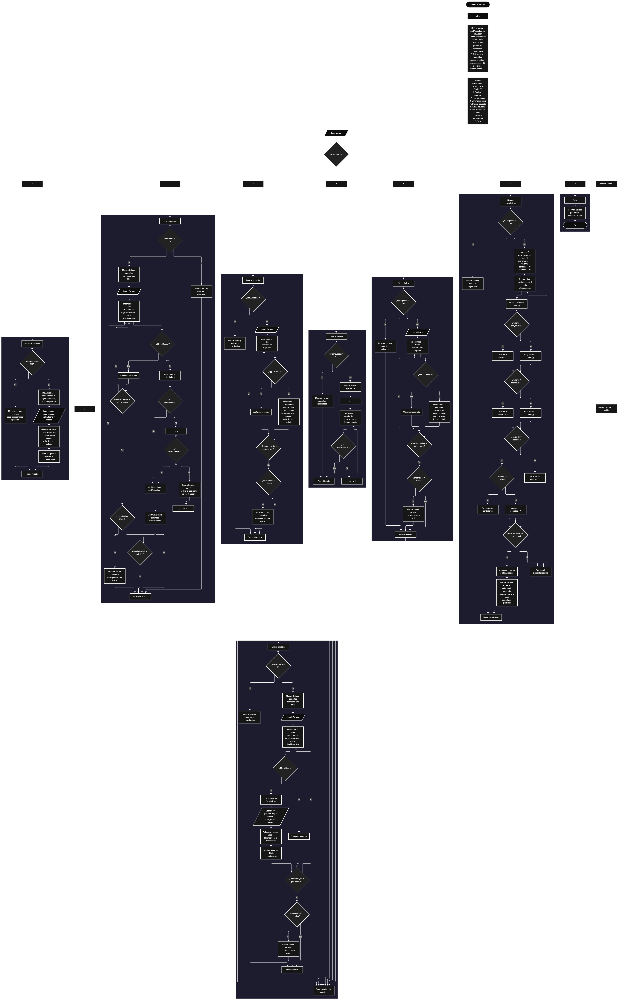

 

Este proyecto, llamado <b>apuestas simples</b>, fue desarrollado en <b>pseint</b> como un ejercicio práctico para fortalecer la lógica de programación mediante la creación de un sistema de gestión de apuestas desde la consola. El programa cuenta con un menú principal de ocho opciones que permite <b>registrar, editar, eliminar, buscar, listar, consultar los detalles y mostrar estadísticas</b> de las apuestas registradas. Cada apuesta almacena información como el identificador, el nombre del jugador, el juego, el número apostado, el valor de la apuesta, la fecha y el estado del resultado. Para administrar esta información, se utilizan siete arreglos con una capacidad máxima de <b>100 apuestas durante la ejecución</b>. Durante su desarrollo se aplicaron conceptos fundamentales de programación, como variables, arreglos, estructuras condicionales, ciclos repetitivos y estructuras de selección, además de procesos para buscar, modificar, eliminar y reorganizar registros. También se incorporaron cálculos estadísticos para conocer el valor total apostado, el promedio, los valores mayor y menor, y las cantidades de apuestas ganadas y perdidas. Este proyecto permite poner en práctica los conocimientos adquiridos en PSeInt y sirve como base para desarrollar sistemas de gestión más avanzados utilizando otros lenguajes y tecnologías.

<h2 align="center">⚙️ Funcionamiento del menú principal</h2>

### ➕ Registrar apuesta

La opción <b>1) registrar apuesta</b> permite agregar una nueva apuesta al sistema. Antes de realizar el registro, el programa comprueba que la cantidad de apuestas almacenadas sea menor que <b>100</b>, utilizando la condición <b>totalApuestas &lt; 100</b>. Si existe espacio disponible, la variable <b>totalApuestas</b> aumenta en uno y el identificador se asigna mediante la instrucción <b>id[totalApuestas] &lt;- totalApuestas</b>. Después, el programa solicita el <b>nombre del jugador, el juego, el número apostado, el valor apostado, la fecha y el estado</b>, almacenando cada dato en la posición correspondiente de su respectivo arreglo. Finalmente, muestra el mensaje <b>"apuesta registrada correctamente."</b>. Si se alcanza la capacidad máxima, presenta el mensaje <b>"no hay espacio para registrar mas apuestas."</b>, impidiendo registrar otra apuesta mientras no haya espacio disponible.

### ✏️ Editar apuesta

La opción <b>2) editar apuesta</b> permite modificar la información de una apuesta registrada. Primero, el programa comprueba si existen apuestas almacenadas mediante la variable <b>totalApuestas</b>. Si no hay registros, muestra el mensaje <b>"no hay apuestas registradas."</b>. En caso contrario, presenta una lista con el identificador, el jugador, el juego, el número, el valor, la fecha y el estado de cada apuesta. Después, solicita el identificador mediante la variable <b>idBuscar</b> e inicializa la variable lógica <b>encontrado</b> con el valor <b>Falso</b>. A continuación, recorre los identificadores almacenados utilizando un ciclo <b>Para</b>. Cuando encuentra una coincidencia, cambia <b>encontrado</b> a <b>Verdadero</b> y solicita los nuevos datos del jugador, juego, número, valor, fecha y estado, actualizando directamente los arreglos correspondientes. El identificador no se modifica. Finalmente, muestra el mensaje <b>"apuesta editada correctamente."</b>. Si el recorrido termina sin encontrar el identificador solicitado, presenta el mensaje <b>"no se encontr&oacute; una apuesta con ese id."</b>.

### 🗑️ Eliminar apuesta

La opción <b>3) eliminar apuesta</b> permite eliminar una apuesta registrada mediante su identificador. Primero, el programa comprueba si existen apuestas almacenadas. Si no hay registros, muestra el mensaje <b>"no hay apuestas registradas."</b>. En caso contrario, presenta una lista con los datos de las apuestas y solicita el identificador que se desea eliminar. Después, inicializa la variable <b>encontrado</b> con el valor <b>Falso</b> y recorre los registros mediante un ciclo <b>Para</b>. Cuando encuentra una coincidencia, cambia la variable a <b>Verdadero</b>. Si la posición seleccionada es anterior a la última apuesta, utiliza otro ciclo <b>Para</b>, controlado por la variable <b>j</b>, para desplazar una posición hacia atrás los datos de los arreglos <b>id, jugador, juego, numero, valor, fecha y estado</b>. Posteriormente, disminuye <b>totalApuestas</b> en uno y muestra el mensaje <b>"apuesta eliminada correctamente."</b>. Si no encuentra el identificador, presenta el mensaje <b>"no se encontr&oacute; una apuesta con ese id."</b>. El código no limpia explícitamente la última posición después de la eliminación y continúa el recorrido exterior después de encontrar una coincidencia. Por ello, la reorganización y la reducción del contador deben entenderse de acuerdo con la lógica implementada actualmente.

### 🔎 Buscar apuesta

La opción <b>4) buscar apuesta</b> permite localizar una apuesta mediante su identificador. Primero, el programa comprueba si existen registros. Si no hay apuestas almacenadas, muestra el mensaje <b>"no hay apuestas registradas."</b>. En caso contrario, solicita el identificador mediante la variable <b>idBuscar</b> e inicializa la variable lógica <b>encontrado</b> con el valor <b>Falso</b>. Después, utiliza un ciclo <b>Para</b> para recorrer los identificadores almacenados y compararlos con el valor introducido mediante la condición <b>id[i] = idBuscar</b>. Cuando encuentra una coincidencia, cambia <b>encontrado</b> a <b>Verdadero</b>, muestra el mensaje <b>"datos encontrados"</b> y presenta el identificador, el jugador, el juego, el número, el valor, la fecha y el estado de la apuesta. Si finaliza el recorrido sin encontrar coincidencias, muestra el mensaje <b>"no se encontr&oacute; una apuesta con ese id."</b>. La búsqueda utiliza el identificador como criterio para localizar los registros.

### 📋 Listar apuestas

La opción <b>5) listar apuestas</b> permite visualizar todas las apuestas registradas actualmente. Antes de mostrar la información, el programa comprueba si la variable <b>totalApuestas</b> es igual a <b>0</b>. Si no existen registros, presenta el mensaje <b>"no hay apuestas registradas."</b>. Si hay apuestas disponibles, muestra el encabezado <b>"datos registrados"</b> y utiliza un ciclo <b>Para</b> para recorrer los arreglos desde la primera posición hasta el número total de apuestas registradas. Durante el recorrido, presenta el identificador, el jugador, el juego, el número apostado, el valor, la fecha y el estado de cada registro. Esta función facilita consultar las apuestas existentes sin necesidad de buscar cada una individualmente.

### 📄 Ver detalles de la apuesta

La opción <b>6) ver detalles de la apuesta</b> permite consultar individualmente toda la información de una apuesta específica. Primero, el programa comprueba si existen apuestas registradas. Si no hay registros, muestra el mensaje <b>"no hay apuestas registradas."</b>. En caso contrario, solicita el identificador de la apuesta y establece la variable <b>encontrado</b> en <b>Falso</b>. Después, recorre los identificadores utilizando un ciclo <b>Para</b>. Si encuentra el identificador solicitado, cambia la variable a <b>Verdadero</b> y muestra el encabezado <b>"detalles de la apuesta"</b>, seguido de los siete campos: <b>id, jugador, juego, numero, valor, fecha y estado</b>. Si el identificador no aparece en el recorrido, presenta el mensaje <b>"no se encontr&oacute; una apuesta con ese id."</b>. Esta opción permite consultar los datos de un registro de forma más detallada que el listado general.

### 📊 Mostrar estadísticas

La opción <b>7) mostrar estadísticas</b> permite analizar los valores y resultados de las apuestas registradas. Primero, el programa comprueba si existen apuestas almacenadas. Si no hay registros, muestra el mensaje <b>"no hay apuestas registradas."</b>. En caso contrario, inicializa la variable <b>suma</b> en cero, establece <b>mayorValor</b> y <b>menorValor</b> con el valor de la primera apuesta e inicializa los contadores <b>ganadas</b> y <b>perdidas</b> en cero. A continuación, utiliza un ciclo <b>Para</b> para recorrer las apuestas y acumular sus valores en <b>suma</b>. Durante el recorrido, compara cada importe con <b>mayorValor</b> y <b>menorValor</b> para actualizar los valores máximo y mínimo. También comprueba el contenido de <b>estado[i]</b>: si es igual a <b>"ganada"</b>, aumenta el contador de apuestas ganadas; si es igual a <b>"perdida"</b>, aumenta el contador de apuestas perdidas. Al finalizar, calcula el promedio mediante la operación <b>promedio &lt;- suma / totalApuestas</b>. Finalmente, presenta el total de apuestas, el valor total apostado, el promedio, la apuesta mayor, la apuesta menor y las cantidades de apuestas ganadas y perdidas. Los conteos de resultados dependen de que el estado coincida exactamente con los textos establecidos en el código.

### 🚪 Salir del menú principal

La opción <b>8) salir</b> está destinada a finalizar la ejecución del programa y muestra el mensaje <b>"gracias por utilizar apuestas simples."</b>. El menú principal se encuentra dentro de una estructura repetitiva <b>Repetir ... Hasta Que</b>, que mantiene el programa en funcionamiento mientras se realizan las operaciones disponibles. En el código actual, la condición final es <b>Hasta Que opcion = 8</b>, por lo que la ejecución del ciclo termina cuando el usuario selecciona la opción <b>8</b>. De esta manera, el número de la opción de salida coincide con la condición utilizada para finalizar el menú.

<h2 align="center">🧠 Temas aplicados en el proyecto</h2>

### 📦 Variables

En este proyecto se utilizan variables para controlar la opción seleccionada en el menú, almacenar la cantidad de apuestas registradas, recorrer los arreglos, identificar la apuesta que se desea modificar, eliminar o consultar, y comprobar si se encontró una coincidencia. También se emplean variables numéricas para calcular las estadísticas y contadores para registrar las cantidades de apuestas ganadas y perdidas. Cada variable cumple una función específica dentro de las operaciones de gestión y análisis de apuestas.

🔢 **Opcion:** Almacena la opción seleccionada por el usuario en el menú principal.

📊 **TotalApuestas:** Almacena la cantidad actual de apuestas registradas.

🔄 **I:** Funciona como contador en los ciclos <b>Para</b> y permite recorrer los registros de los arreglos.

🔁 **J:** Controla el recorrido utilizado para desplazar los datos durante la eliminación de una apuesta.

🔎 **IdBuscar:** Almacena el identificador introducido por el usuario para localizar una apuesta.

✅ **Encontrado:** Variable lógica que indica si se encontró una apuesta con el identificador solicitado.

💰 **Suma:** Acumula los valores de todas las apuestas registradas para calcular el importe total apostado.

📈 **Promedio:** Almacena el resultado de dividir la suma de los valores apostados entre el total de apuestas.

⬆️ **MayorValor:** Guarda el valor más alto entre los importes de las apuestas registradas.

⬇️ **MenorValor:** Guarda el valor más bajo entre los importes de las apuestas registradas.

🏆 **Ganadas:** Cuenta las apuestas cuyo estado es exactamente igual a <b>"ganada"</b>.

📉 **Perdidas:** Cuenta las apuestas cuyo estado es exactamente igual a <b>"perdida"</b>.

### 🗃️ Arreglos

En este proyecto se utilizan siete arreglos relacionados con la información de cada apuesta. Cada arreglo tiene una capacidad de <b>100 posiciones</b> y utiliza el mismo índice para representar los datos correspondientes a un mismo registro. Por ejemplo, la información de una apuesta almacenada en la posición <b>1</b> se distribuye entre <b>id[1], jugador[1], juego[1], numero[1], valor[1], fecha[1] y estado[1]</b>. Esta organización permite recorrer, buscar, modificar, mostrar y reorganizar las apuestas mediante posiciones relacionadas. La variable <b>totalApuestas</b> controla la cantidad de registros que el programa considera activos.

🆔 **Id[100]:** Almacena los identificadores asignados a las apuestas.

👤 **Jugador[100]:** Almacena los nombres de los jugadores asociados a cada apuesta.

🎮 **Juego[100]:** Almacena el nombre del juego en el que se realiza la apuesta.

🔢 **Numero[100]:** Almacena el número seleccionado en cada apuesta.

💵 **Valor[100]:** Almacena el importe apostado.

📅 **Fecha[100]:** Almacena la fecha correspondiente a cada apuesta.

📌 **Estado[100]:** Almacena el resultado registrado de la apuesta, como ganada o perdida.

### 🔀 Estructuras condicionales

En este proyecto se utilizan las estructuras <b>Si</b> y <b>SiNo</b> para comprobar si existe espacio antes de registrar una apuesta, verificar si hay registros antes de ejecutar determinadas operaciones, identificar una apuesta mediante su ID y determinar si se encontró una coincidencia. También se utilizan condiciones para decidir si es necesario desplazar los registros durante la eliminación, comparar los importes para identificar el mayor y el menor valor y clasificar los resultados según el contenido del arreglo <b>estado</b>. Estas condiciones permiten que el programa responda de manera diferente según la información almacenada y los resultados de cada comparación.

### 🔄 Estructuras repetitivas

En este proyecto se utilizan los ciclos <b>Para</b> y <b>Repetir ... Hasta Que</b>. Los ciclos <b>Para</b> permiten recorrer los arreglos para mostrar las apuestas, buscar identificadores, editar registros y calcular las estadísticas. Durante la eliminación, también se utilizan para desplazar los datos de los registros posteriores hacia posiciones anteriores. Por otro lado, el ciclo <b>Repetir ... Hasta Que</b> mantiene activo el menú principal y permite ejecutar diferentes operaciones hasta que el usuario selecciona la opción <b>8</b>. Estas estructuras facilitan la repetición de instrucciones sin necesidad de escribirlas varias veces.

### 🎯 Estructura segun

El programa utiliza la estructura <b>Segun opcion Hacer</b> para evaluar el valor almacenado en la variable <b>opcion</b> y ejecutar el bloque de instrucciones correspondiente. Cada caso representa una operación específica del sistema: <b>registrar apuesta, editar apuesta, eliminar apuesta, buscar apuesta, listar apuestas, ver detalles, mostrar estadísticas o salir</b>. También se utiliza el bloque <b>De Otro Modo</b> para mostrar el mensaje <b>"opcion no valida."</b> cuando el usuario introduce un valor que no coincide con ninguna de las opciones definidas en el menú. Esta estructura organiza las funcionalidades y facilita la navegación por el programa.

### 🔢 Dimensionamiento de arreglos

El programa utiliza la instrucción <b>Dimension</b> para establecer la capacidad de los siete arreglos que almacenan la información de las apuestas. Cada uno dispone de <b>100 posiciones</b>, lo que permite administrar hasta 100 registros activos. La cantidad de posiciones utilizadas se controla mediante la variable <b>totalApuestas</b>, y el registro comprueba la condición <b>totalApuestas &lt; 100</b> antes de agregar una apuesta. De esta manera, el programa impide registrar nuevos datos cuando alcanza la capacidad declarada de los arreglos.

### 🔄 Reorganización de registros

Cuando se selecciona una apuesta para eliminarla, el programa utiliza un ciclo <b>Para</b> controlado por la variable <b>j</b>, que comienza en la posición del registro encontrado y llega hasta <b>totalApuestas - 1</b>. En cada repetición, los datos de la posición siguiente se copian sobre la posición actual en los siete arreglos: <b>id, jugador, juego, numero, valor, fecha y estado</b>. Después, la variable <b>totalApuestas</b> disminuye en uno. Sin embargo, el código no limpia expresamente la última posición y continúa el ciclo exterior después de encontrar el identificador. Además, el contador se modifica dentro de ese recorrido. Por estas razones, el comportamiento de la eliminación depende de la lógica implementada y no debe describirse como una reorganización completamente controlada en todos los casos.

<h2 align="center">¿Cómo se implementaron las operaciones crud en el proyecto?</h2>

Las operaciones <b>crud</b> se implementaron mediante las opciones del menú principal, permitiendo administrar las apuestas registradas. La operación <b>crear</b> corresponde a <b>registrar apuesta</b>, donde se introducen los datos de un nuevo registro; <b>leer</b> se realiza mediante las opciones <b>buscar apuesta, listar apuestas y ver detalles de la apuesta</b>; <b>actualizar</b> corresponde a <b>editar apuesta</b>, donde se modifican los datos de una apuesta existente; y <b>eliminar</b> se realiza mediante la opción <b>eliminar apuesta</b>. Estas operaciones utilizan variables, arreglos, condicionales y ciclos para administrar la información almacenada temporalmente durante la ejecución del programa. El sistema permite organizar y consultar los registros mediante sus identificadores, aunque la asignación de estos depende del total actual de apuestas y puede producir identificadores repetidos después de eliminar registros.

<h2 align="center">Diagrama de flujo del proyecto</h2>

<h2 align="center">🛡️ Validaciones del programa</h2>

### 📭 No existen apuestas registradas

Esta comprobación se utiliza en las opciones de <b>editar, eliminar, buscar, listar, ver detalles y mostrar estadísticas</b>. El programa comprueba si la variable <b>totalApuestas</b> es igual a <b>0</b> y, si no existen apuestas registradas, muestra el mensaje <b>"no hay apuestas registradas."</b>. Esta condición evita realizar las operaciones que necesitan datos almacenados cuando el sistema se encuentra vacío.

### ⚠️ Capacidad máxima de apuestas

Esta validación se utiliza durante el registro de nuevas apuestas para controlar la capacidad de los arreglos. El programa comprueba si <b>totalApuestas &lt; 100</b> antes de permitir un nuevo registro. Si existe espacio disponible, aumenta el contador y solicita los datos de la apuesta. En caso contrario, muestra el mensaje <b>"no hay espacio para registrar mas apuestas."</b>, impidiendo registrar más apuestas cuando se alcanza la capacidad máxima de 100 posiciones.

### ❌ Apuesta no encontrada

Esta comprobación se utiliza en las operaciones de edición, eliminación, búsqueda y consulta de detalles. El programa inicializa la variable lógica <b>encontrado</b> con el valor <b>Falso</b> y recorre el arreglo <b>id</b> para comparar los identificadores almacenados con el valor introducido por el usuario. Cuando encuentra una coincidencia, cambia la variable a <b>Verdadero</b> y ejecuta las instrucciones correspondientes a la operación seleccionada. Si al finalizar el recorrido la variable continúa siendo <b>Falso</b>, muestra el mensaje <b>"no se encontr&oacute; una apuesta con ese id."</b>. Esta comprobación permite informar al usuario cuando el identificador solicitado no coincide con los registros recorridos.

### 🔢 Identificadores de las apuestas

Al registrar una apuesta, el programa asigna el identificador mediante la instrucción <b>id[totalApuestas] &lt;- totalApuestas</b>, después de aumentar la variable <b>totalApuestas</b>. Por lo tanto, el identificador depende de la cantidad actual de registros activos. Como no se utiliza una variable independiente para generar identificadores consecutivos, después de eliminar una apuesta y registrar otra pueden repetirse identificadores que ya se habían utilizado. El código no incluye una validación adicional para impedir esa repetición.

### 📊 Cálculo de estadísticas

Antes de calcular las estadísticas, el programa comprueba que exista al menos una apuesta registrada. Si hay registros, inicializa las variables utilizadas para acumular los importes, determinar el valor mayor y menor y contar las apuestas ganadas y perdidas. El promedio se calcula dividiendo la suma entre <b>totalApuestas</b>, mientras que los contadores de resultados dependen de que el contenido de <b>estado</b> coincida exactamente con <b>"ganada"</b> o <b>"perdida"</b>. El programa no valida que todos los estados introducidos correspondan a esas dos palabras; por ello, otros valores no se incluyen en ninguno de los dos contadores.

### ⚠️ Datos de las apuestas

El programa solicita el jugador, el juego, el número apostado, el valor, la fecha y el estado, pero no incorpora comprobaciones específicas para validar todos esos datos. En particular, no verifica que el valor apostado sea positivo, que el número introducido sea válido, que la fecha tenga un formato correcto ni que el estado se limite a <b>"ganada"</b> o <b>"perdida"</b>. Por lo tanto, los datos ingresados se almacenan según las instrucciones del código y pueden influir en los resultados de las estadísticas aunque no cumplan un formato o criterio esperado.

### 🚪 Opción de salida

La estructura repetitiva del menú utiliza la condición <b>Hasta Que opcion = 8</b> para finalizar la ejecución del ciclo. La opción <b>8) salir</b> muestra el mensaje de despedida y coincide con el valor que comprueba la condición final. Cuando el usuario selecciona una opción diferente, el menú continúa mostrando las operaciones disponibles. Si introduce un número que no corresponde a ninguna opción, el bloque <b>De Otro Modo</b> muestra el mensaje <b>"opcion no valida."</b>.

### 💾 Almacenamiento temporal

Los datos de las apuestas se almacenan en los arreglos durante la ejecución del programa. El código no incorpora instrucciones para guardar la información en archivos ni en una base de datos, por lo que los registros se mantienen únicamente mientras el programa está en funcionamiento. Al finalizar la ejecución, la información almacenada en memoria no queda guardada de manera permanente.

<h2 align="center">🎯 Objetivo del proyecto</h2>

El objetivo principal de este proyecto es fortalecer la <b>lógica de programación</b> mediante el desarrollo de un sistema de gestión de apuestas en <b>pseint</b>. A través de su construcción se busca aplicar los conocimientos adquiridos sobre variables, arreglos, estructuras condicionales, ciclos repetitivos y estructuras de selección, integrándolos para resolver un problema de manera organizada. Además, el proyecto permite comprender cómo registrar, consultar, modificar y eliminar información, así como calcular estadísticas a partir de los datos almacenados. De esta manera, se establece una base para desarrollar sistemas de gestión más completos utilizando otros lenguajes y tecnologías.

